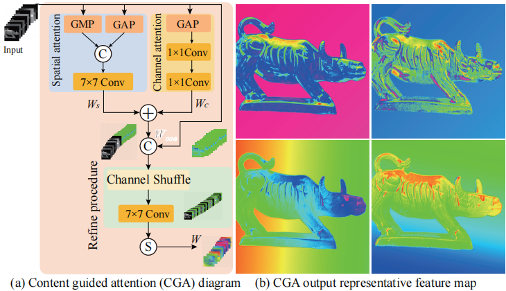

# Shape from polarization via physical prior-based deep fusion network with ambiguous surface normals

## **News**
- [2025/07] Our paper got accepted to Optics Express 2025! [Paper](https://opg.optica.org/oe/fulltext.cfm?uri=oe-33-14-29255&id=573472)


## Introduction
we propose a novel method that fuses polarization information with ill-posed physical models, incorporating ambiguous surface normals and a specular confidence mechanism specifically designed for highly reflective regions. To efficiently fuse these features in complex scenes, we design a novel dual-branch deep fusion network, which introduces a coarse-to-fine hybrid fusion scheme based on Content-Guided Attention (CGA) and a Transformer Encoder module for global feature extraction.
Extensive experiments conducted under challenging conditions-including multi-illumination, low-texture, and strong specular reflections-demonstrate that our method outperforms existing SfP approaches in both qualitative and quantitative evaluations.

 


## Dependencies and Installation
### Envitonment
Environment This code is based on PyTorch. It has been tested on Ubuntu 22.04.

```python
conda env create -f environment.yml
conda activate VITPhase
```

## Data
### Simulation dataset
#### DeepSfP
#### SPW
#### Real-world scene datasets
## Train and test
```python
train.py
prediction.py
```


## Citation
If you find this code useful for your research, please cite our paper:

```
@article{Wang,
author = {Baolin Wang and Cheng Zhou and Yanli Meng and Jipeng Huang},
journal = {Opt. Express},
keywords = {Biomedical imaging; Imaging techniques; Neural networks; Polarimetric imaging; Three dimensional imaging; Three dimensional reconstruction},
number = {14},
pages = {29255--29269},
publisher = {Optica Publishing Group},
title = {Shape from polarization via a physical prior-based deep fusion network with ambiguous surface normals},
volume = {33},
month = {Jul},
year = {2025}
}
```
